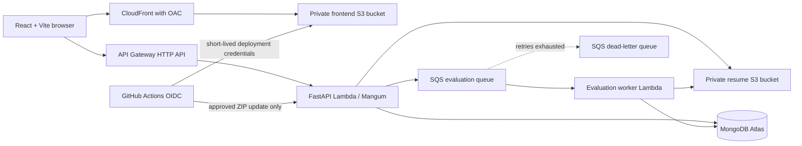

# CareerLens-AI AWS Architecture

## Status and scope

This document describes the intended AWS migration architecture and separates repository configuration from infrastructure that has not been verified. No AWS resources are created or modified by this repository documentation.

## Target request and data flows

## Component responsibilities

- **Frontend delivery:** React/Vite assets are stored in the existing frontend bucket where verified. The bucket should remain private and be served through CloudFront Origin Access Control. Configure HTTPS, default root object, and SPA route fallback on CloudFront. S3 website hosting requires public access and is not the recommended production origin.
- **API:** API Gateway HTTP API forwards browser requests to the existing FastAPI app through Mangum (`main.handler`). Authentication and owner checks remain in the application. Configure throttling and access logging in AWS after target resources are identified.
- **Resume storage:** The API accepts bounded multipart PDF uploads, verifies/extracts the document, writes the binary to a private S3 bucket, and persists owner-scoped metadata and extracted text in MongoDB. The browser never receives AWS credentials or an unrestricted object key.
- **Evaluation:** The authenticated API validates the owner's resume session, stores a persistent job record, and sends an SQS message containing only the job ID. The worker retrieves the job and owner-scoped resume record, reads the object from S3, runs the shared evaluation pipeline, and records the result/status in MongoDB. Repeated messages must be idempotent; configure queue visibility timeout, bounded redrive attempts, and a DLQ.
- **Database:** MongoDB Atlas remains the durable source for users, resume metadata, evaluation jobs/results, and history. The Atlas network access path and production URI are external configuration and have not been verified here.
- **CI/CD:** GitHub Actions uses OIDC and a production GitHub environment for short-lived credentials. CI builds/tests/packages only. CD is manually triggered and must require the configured production environment approval and explicit resource variables.

## Repository configuration versus AWS verification

| Item | Repository state | AWS state |
| --- | --- | --- |
| FastAPI + Mangum | Present | Lambda and API Gateway targets unverified |
| Resume S3 service | Present in backend code | Bucket existence, privacy, encryption, and role access unverified |
| Evaluation SQS workflow | Producer and worker code present | Queue, DLQ, event source mapping, and worker Lambda unverified |
| Frontend S3 | Existing workflow targets `amzn-careerlens-ai` through variables | Bucket privacy/website/CloudFront state unverified |
| OIDC | Workflows use role variables and `id-token` permission | Provider, trust policy, role policies, and repository variables unverified |

Do not treat a name in source or workflow configuration as evidence that a resource exists. Do not record account IDs, role ARNs, bucket URLs, API URLs, function names, queue URLs, or distribution IDs until read-only verification confirms them.

## Required configuration (values intentionally omitted)

- Application Lambda: `AWS_REGION`, `MONGO_URI`, `GROQ_API_KEY`, `S3_RESUME_BUCKET`, and `CORS_ALLOWED_ORIGINS`.
- Evaluation API Lambda: `EVALUATION_QUEUE_URL` and suitable SQS send permission.
- Worker Lambda: SQS event source mapping with partial batch failure reporting, SQS receive/delete/get-attributes permissions, S3 object read permission, MongoDB connectivity, and a bounded timeout.
- Queue: visibility timeout exceeding worker timeout; redrive policy to a DLQ after a bounded receive count.
- Frontend build/deploy: `VITE_API_BASE_URL`, `AWS_REGION`, `AWS_S3_BUCKET`, OIDC role, and CloudFront distribution identifier if invalidation is used.
- Backend ZIP deploy: OIDC role, region, approved Lambda function name, and private artifact bucket. Lambda execution role and deployment role are distinct least-privilege identities.
- GitHub production environment: require reviewers before deployment. Its protection settings were not verified.

## IAM permission boundaries to configure

- **Frontend OIDC deploy role:** `s3:ListBucket` on the verified frontend bucket; `s3:PutObject`, `s3:GetObject`, and `s3:DeleteObject` on its static asset prefix; `cloudfront:CreateInvalidation` and `cloudfront:GetInvalidation` on the verified distribution.
- **Backend OIDC deploy role:** `s3:PutObject` to the private artifact prefix, `s3:GetObject` for the deployment artifact, and `lambda:GetFunctionConfiguration` / `lambda:UpdateFunctionCode` only for the verified API and worker functions. The current workflow does not need `iam:PassRole` because it updates code only.
- **API Lambda execution role:** scoped resume-object upload/read/delete actions required by the current API flow, `sqs:SendMessage` to the evaluation queue, and CloudWatch log stream/write actions.
- **Worker Lambda execution role:** `s3:GetObject` for private resumes, SQS receive/delete/get-attributes actions for its queue, and CloudWatch log stream/write actions. It should not receive frontend bucket or deployment permissions.

These are required action scopes derived from workflow/application calls, not evidence that policies or resources currently exist. Restrict all resources to verified bucket prefixes, queues, functions, and distributions; AWS policy state has not been inspected in this phase.
## Security decisions and open verification

- Keep resume and frontend origin buckets private; never add public read ACLs or public bucket policies for resumes.
- Use CloudFront OAC for frontend reads and short-lived signed requests only where an authenticated application path requires them.
- Limit S3 policies to required object prefixes and actions. Separate API publisher, worker, and GitHub deployer permissions.
- Restrict OIDC trust to this repository and the protected production environment/branch.
- Keep MongoDB/Groq credentials in runtime secret configuration, never in the frontend bundle, workflow output, ZIP, or repository.
- Verify API Gateway authorizer/throttling, Lambda environment/log settings, SQS/DLQ policy, bucket public-access block/encryption, Atlas network access, and CloudFront origin policy before production readiness is claimed.
